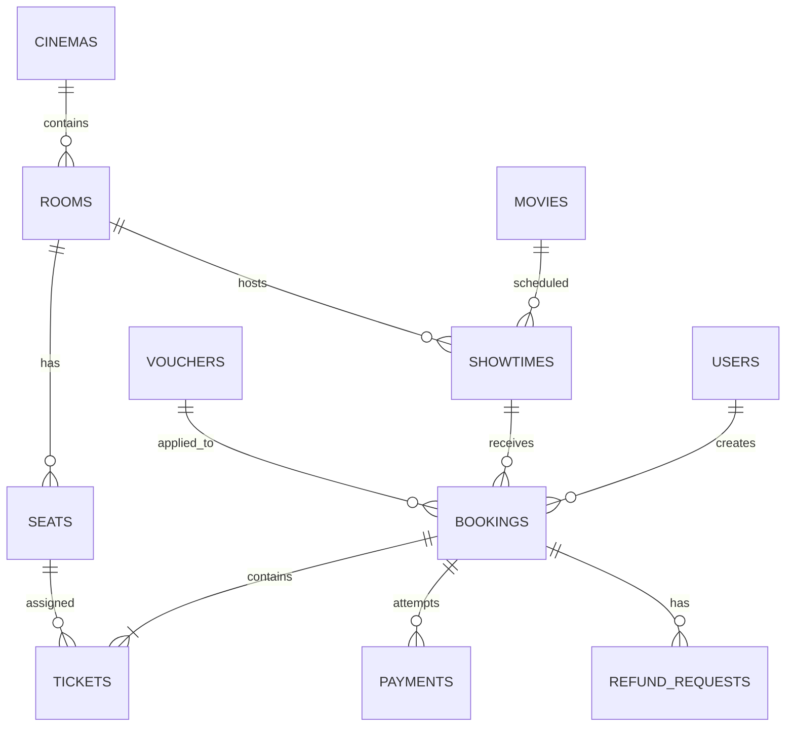

# Kiến trúc hệ thống CinemaStar

## Vai trò và luồng chính

| Vai trò | Phạm vi |
|---|---|
| Khách hàng | Xem lịch, chọn ghế, thanh toán, xem vé, yêu cầu hoàn tiền |
| Nhân viên | Quét QR/mã BK và check-in khách |
| Quản trị viên | Quản lý rạp, nội dung, lịch chiếu, ưu đãi, tài khoản và báo cáo |

Luồng đặt vé: **chọn phim → chọn suất → chọn ghế → giữ ghế → thanh toán → xác nhận email/QR → check-in**.

Nếu khách chọn ghế trước khi đăng nhập, trang chọn ghế lưu lựa chọn ở trình duyệt. Sau khi đăng nhập/đăng ký, Laravel chuyển khách về lại suất chiếu đó.

## Mô hình dữ liệu

## Quy tắc nghiệp vụ

1. Tạo booking chạy trong transaction và khóa dữ liệu suất chiếu/ghế để không bán trùng.
2. Booking chưa thanh toán có thời hạn. Scheduler xóa ticket tạm giữ và trả điểm đã dùng khi hết hạn.
3. Giá do server tính từ giá suất chiếu, loại ghế, voucher và điểm; không nhận giá từ trình duyệt.
4. Ghế VIP E–G phụ thu 30.000₫/ghế. Ghế đôi H được hiển thị theo cặp; một lựa chọn luôn tạo hai ticket vật lý để kiểm soát chỗ ngồi và có giá `2 × (giá cơ bản + 30.000₫) + 30.000₫`.
5. Một ghế đôi không thể bị đặt một nửa: hệ thống tự thêm ghế còn lại của cặp và từ chối khi một trong hai đã được giữ/mua.
6. Mỗi đơn có một mã BK và một QR xác thực ký HMAC. Admin/Staff quét QR đó để check-in toàn bộ ticket hợp lệ trong đơn; quét lại bị từ chối.
7. Callback SePay/MoMo/VNPAY kiểm tra mã đơn, số tiền và chữ ký/khóa xác thực trước khi đổi payment thành công. Xử lý lặp không cộng điểm hoặc gửi email lần hai.
8. Email chỉ được gửi sau khi transaction thanh toán hoàn tất. QR PNG trong email được tạo bằng PHP GD.
9. Voucher được tính trước, sau đó mới đổi điểm. Điểm được cộng đúng một lần sau thanh toán và hoàn lại khi đơn chưa thanh toán bị hủy/hết hạn.
10. Suất chiếu trùng phòng bị chặn; giờ kết thúc gồm thời lượng phim cộng 15 phút chuẩn bị phòng.

## Trạng thái

| Thực thể | Mã lưu trữ | Hiển thị |
|---|---|---|
| Booking | pending, confirmed, cancelled, expired | Chờ thanh toán, Đã thanh toán, Đã hủy, Đã hết hạn |
| Payment | initiated, pending, success, failed | Khởi tạo, Chờ thanh toán, Thành công, Thất bại. Payment `failed` có `response_code` thuộc `Payment::MANUAL_REFUND_REASONS` là tiền đã nhận nhưng không xác nhận được đơn; hiện ở Dashboard để hoàn thủ công |
| Ticket | valid, used | Sẵn sàng vào rạp, Đã check-in |
| Showtime | scheduled, cancelled | Đang hoạt động, Đã hủy |

## Tổ chức mã nguồn

- `app/Services/BookingService.php`: transaction giữ ghế, ghế đôi, giá, voucher và ticket.
- `app/Services/PaymentGatewayService.php`: SePay QR, URL thanh toán và xác thực callback.
- `app/Http/Controllers/PaymentController.php`: tạo giao dịch, webhook và gửi email sau thanh toán.
- `app/Http/Controllers/Admin/TicketController.php`: quét QR/mã BK và check-in cả đơn.
- `app/Notifications/PaymentReceiptNotification.php`: email vé và QR PNG.
- `resources/views/showtimes/show.blade.php`: sơ đồ ghế, VIP, ghế đôi và lưu lựa chọn trước đăng nhập.
- `resources/views/layouts/app.blade.php`: layout chung; Bootstrap 5, icon và font được đóng gói bằng Vite, không phụ thuộc CDN. `layouts/auth.blade.php` là khung cho các trang tài khoản.
- `resources/css/app.css`, `resources/js/app.js`: giao diện chung và vẽ QR vé trên trình duyệt (`ticket-qr.js`, thư viện `qrcode`), được Vite build vào `public/build`.
- `database/migrations`: cấu trúc dữ liệu, cập nhật hàng E–G VIP và hàng H ghế đôi.

## Hoàn thủ công và vận hành

- `ManualRefundService` khóa payment, đánh dấu ngày/người/ghi chú xử lý đúng một lần và ghi ActivityLog. Không thay trạng thái hoặc response_code của biên lai ngân hàng.
- Dashboard dùng scope `awaitingManualRefund`; `/admin/manual-refunds` giữ cả khoản đã xử lý cho đối soát. Chỉ admin được truy cập.
- `resources/js/checkin.js` chỉ tải ở trang check-in; trình quét QR không cần CDN. Mất mạng vẫn cần kết nối được tới máy chủ CinemaStar; ảnh poster bên ngoài cần mạng.
- `deploy/start.sh` cho phép chạy scheduler cùng web bằng RUN_SCHEDULER, dùng thay cho Cron Job bên ngoài.

## Hạng thành viên và bắp nước

- Hạng Đồng/Bạc/Vàng dựa trên `users.lifetime_points`, ngưỡng 0/300/1000. Migration backfill một lần bằng tổng `points_earned` của các booking còn `payment_status=paid`. Sau đó thanh toán cộng cả điểm tích lũy và điểm có thể đổi dưới cùng khóa user; hoàn tiền trừ đúng điểm đã cộng, không để âm. Đổi điểm chỉ thay `loyalty_points`, không giảm hạng. Hệ số 1/1.2/1.5 của hạng trước đơn hiện tại được áp khi cộng điểm, làm tròn xuống, đúng một lần.
- `bookings.subtotal` gồm tiền ghế và combo; `concessions_total` là tiền combo trước ưu đãi. Voucher và đơn tối thiểu xét toàn bộ subtotal, sau đó mới đổi điểm. Tiền thực trả, điểm thưởng và tiền hoàn vẫn theo `total_price`.
- `BookingService` bỏ các dòng số lượng0, kiểm tra tối đa 5 loại combo đã chọn, mỗi loại 1–10. Dòng combo được đọc theo ID với shared lock: các đơn có thể đọc đồng thời, còn thay đổi giá/tắt bán phải chờ. Đơn lưu `booking_concessions.unit_price`; sửa giá không đổi đơn cũ. Combo đã xuất hiện trong đơn không thể xóa; admin có thể tắt bán.
- `resources/js/seat-selection.js` là entry Vite riêng cho sơ đồ ghế, combo và tổng tạm tính; lưu lựa chọn theo suất vào localStorage. Server luôn tính lại giá và kiểm tra ghế khi nhận đơn.
- Đơn, email, bản in, vé công khai và trang check-in cùng đọc số lượng/giá combo đã lưu. Hủy hoặc hết hạn giữ lịch sử combo và trả ghế/điểm như trước.
- Pivot `booking_concessions` lưu cả tên combo tại thời điểm đặt; mọi bản vé/email/check-in đọc tên và giá snapshot. Sửa tên hoặc giá danh mục không đổi đơn cũ. Cột name được thêm trực tiếp vào migration tạo bảng của PR #4 vì migration này chưa có trên main/chưa deploy.

Callback đọc bộ đếm sau khi lấy khóa user nên thấy phần thưởng vừa commit từ callback trước, kể cả MySQL REPEATABLE READ. Không đổi isolation, không thêm kết nối hay khóa booking sau user. Thứ tự khóa voucher → booking → user và chống cộng trùng theo `points_earned` giữ nguyên.

`User::lifetimePoints()` đọc trực tiếp cột đã lưu. Hồ sơ và danh sách tài khoản quản trị không SUM lịch sử booking hoặc dùng withSum để đè bộ đếm.

## Báo cáo và nhật ký quản trị

- `ReportService` tổng hợp doanh thu từ payment `success` của booking còn `paid`, loại các đơn đã hoàn. Kỳ 30 ngày lịch Việt Nam bắt đầu 00:00 ngày hiện tại trừ 29 ngày và kết thúc tại thời điểm xem; ngày không bán được điền 0. Biên giờ chuyển về timezone lưu trữ của app, không cần bảng timezone MySQL.
- Top 10 phim cộng tiền thực thu của đơn gắn với suất phim trong kỳ, gồm combo. Không join ticket vào số tiền để tránh nhân doanh thu theo số ghế.
- Lấp đầy ghế tính ticket của đơn paid có success payment trên các suất không hủy, đã kết thúc trong kỳ. Mẫu số cộng `rooms.total_seats` một lần mỗi suất, gồm suất không bán vé; vé thanh toán trước kỳ vẫn là ghế đã bán. Đây là công suất phòng hiện có, chưa có snapshot công suất theo lịch sử.
- Doanh thu vé/combo là tiền sau voucher và đổi điểm, phân bổ theo tỷ lệ giá gốc snapshot trong booking. Phần combo làm tròn tới đồng một lần mỗi đơn; vé nhận phần còn lại, nên tổng khớp tiền thực thu.
- `resources/js/admin-dashboard.js` đóng gói Chart.js qua Vite và chỉ nạp ở dashboard admin. Mỗi biểu đồ có bảng số liệu để đọc khi không dùng canvas/JS.
- `/admin/activity-logs` chỉ GET, admin đọc và lọc nhóm hành động, người thực hiện, ngày Việt Nam, 30 dòng/trang. `ActivityLogService` nạp đối tượng liên quan theo lô từ danh sách model cho phép, xử lý an toàn loại cũ hoặc đối tượng đã xóa. Link payment trỏ vào biên lai trong chi tiết đơn; không công khai raw properties/payload thanh toán.
